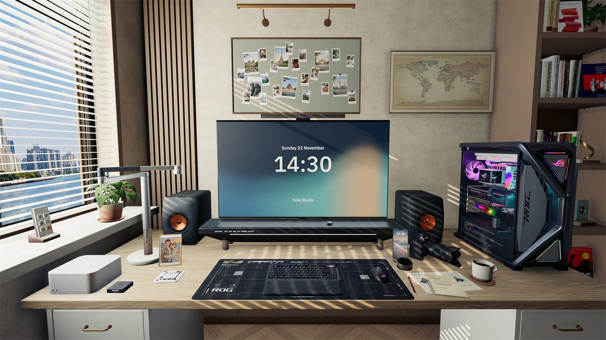

# Felix Yang

**Full-stack engineer building with AI**

I’m a senior software engineer with over a decade of experience in the tech industry. In my own projects, I explore how AI fits into building apps, making videos, and designing games.

[🌐 felixpy.com](https://felixpy.com/) · [𝕏 @gofelixpy](https://x.com/gofelixpy)

## 🖥️ Felix Studio
\
My personal site is an interactive 3D studio built with React and Three.js. Look around the room, change the skyline and weather, or open the in-room computer to browse my profile, play music, and try Orbital Patrol.

[Explore the studio ↗](https://felixpy.com/) · [View the source ↗](https://github.com/felixpy/felixpy.com)
